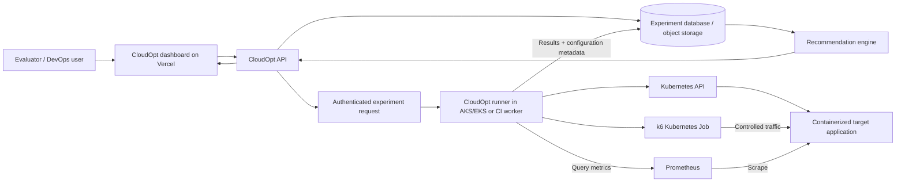

# CloudOpt deployment architecture

## Evaluation deployment

The current demonstrable application is deployed as one Vercel project:

**Production URL:** https://cloudopt-ai-tau.vercel.app 
**Verified:** 16 November 2026

- React/Vite provides the dashboard.
- FastAPI runs as a Vercel Python Function.
- FastAPI serves the built SPA, API documentation, frozen experiment dataset,
  comparison, and recommendation endpoints on one domain.
- SQLite under `/tmp` supports the small product/order demo only. It is
  ephemeral on Vercel and is not the experiment system of record.

This version demonstrates the complete measured-data-to-recommendation path. It
does not execute k6, deploy containers, or mutate Kubernetes resources.

## Intended AKS/EKS experiment architecture

## Experiment flow

1. Register an approved target environment; do not accept arbitrary public URLs.
2. Select a workload profile and an allowlisted resource-profile grid.
3. The runner patches a dedicated test Deployment or creates an isolated Job.
4. Wait for rollout readiness and run a warm-up.
5. Execute k6 from inside the cluster for each resource profile.
6. Query Prometheus for latency, failures, CPU, memory, and replica evidence.
7. Store raw results with cluster, image digest, workload, and resource metadata.
8. Apply the transparent SLO rule and persist the recommendation.
9. Display the experiment status, evidence, recommendation, and limitations.
10. Restore or delete temporary Kubernetes resources.

## Security and safety boundary

- Vercel must not receive a kubeconfig or unrestricted cloud credential.
- The runner uses a namespace-scoped Kubernetes service account and an
  allowlist of target Deployments.
- Experiment requests require authentication and an idempotency key.
- Target URLs, container images, workload limits, and resource grids are
  validated server-side to prevent SSRF and uncontrolled load generation.
- k6 duration, VUs, CPU, memory, replicas, and total concurrent experiments are
  capped.
- Every run records who requested it, what changed, and whether cleanup passed.
- Public evaluation mode remains read-only and uses the frozen dataset.

## Honest evaluation statement

The Vercel application proves the dashboard, API, dataset, selection rule, and
baseline comparison. The repository's Docker target, k6 scripts, Prometheus
configuration, and Kubernetes architecture show how live experiments will be
connected. A claim that the Vercel UI currently runs AKS/EKS experiments should
only be made after the runner, authentication, persistent store, and cleanup
workflow are implemented and validated.
