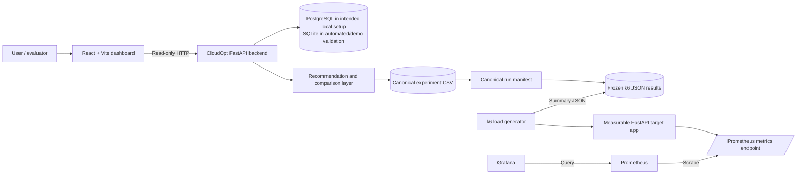
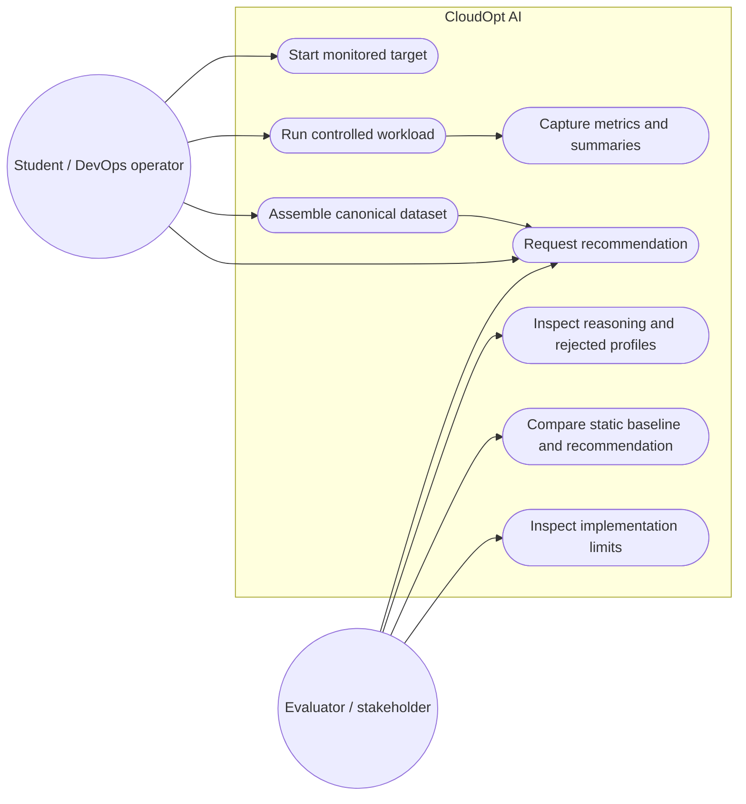
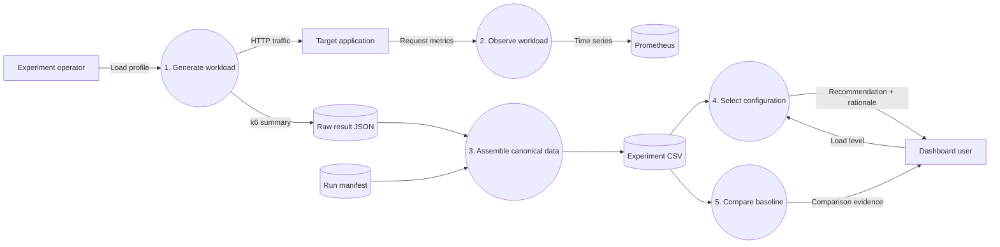
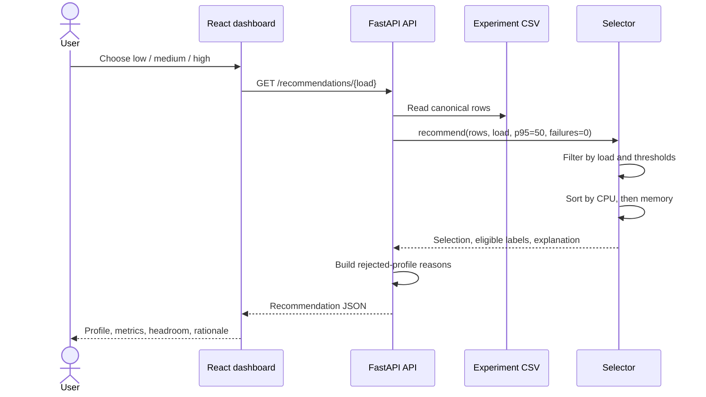
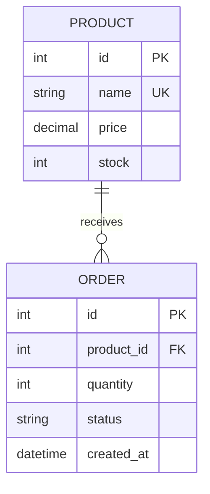
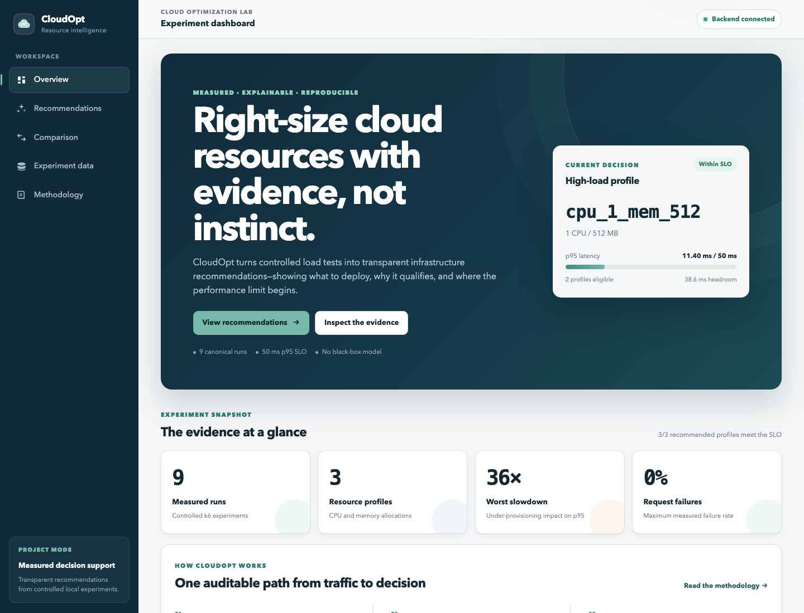
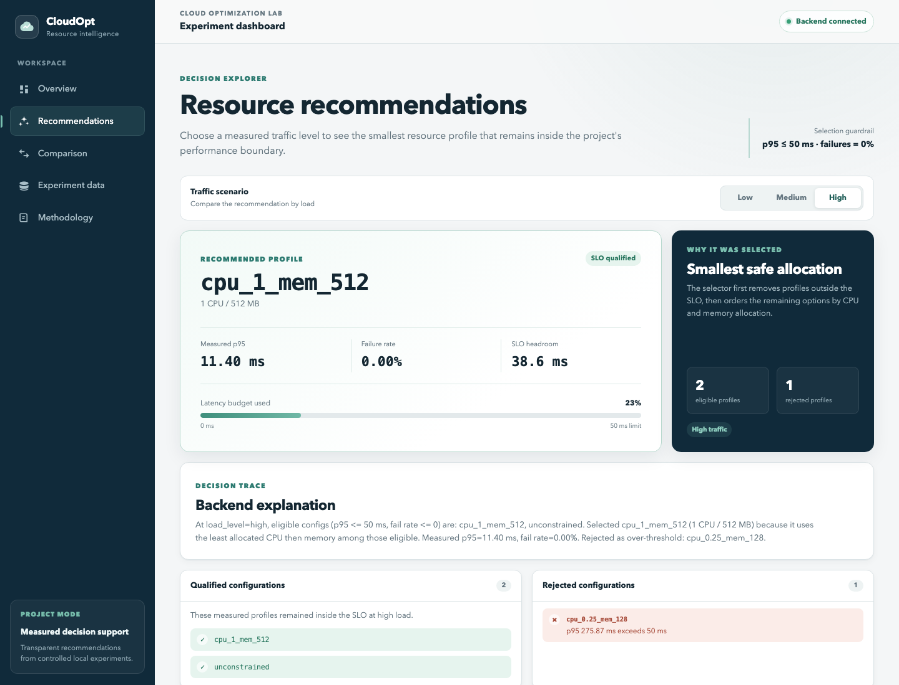
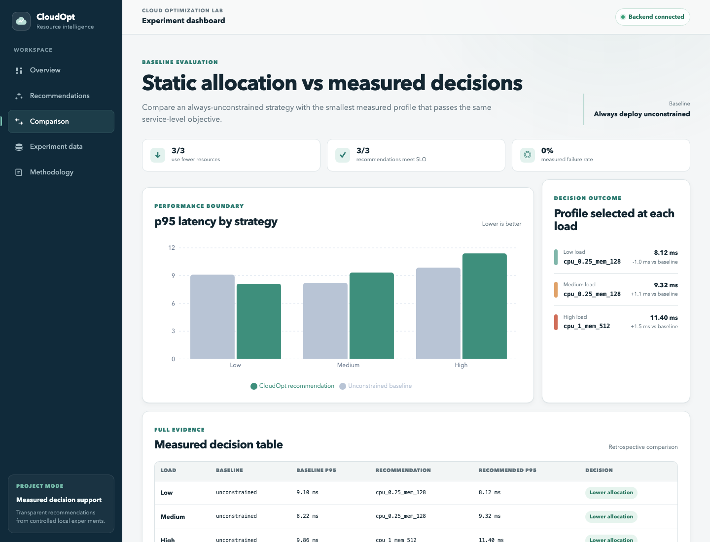
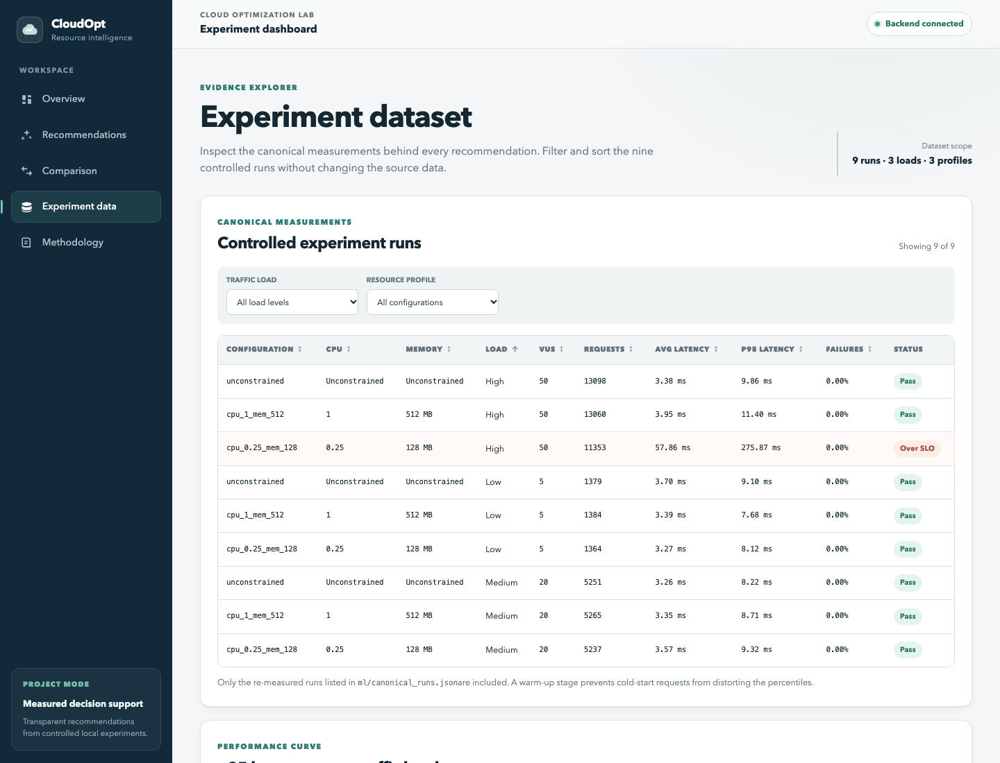
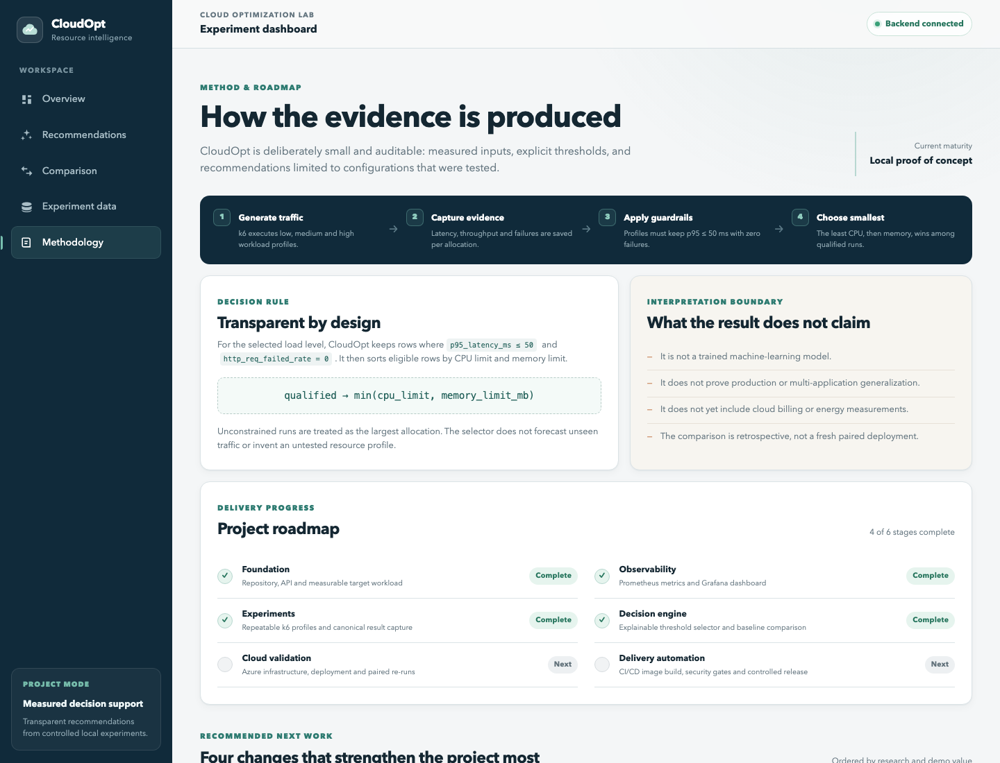

# CloudOpt AI — Evaluation Pack

**Project:** AI-Assisted Cloud Resource Optimization (CloudOpt AI)<br>
**Student:** Sarthak Bordia<br>
**Programme:** B.Tech CSE (DevOps Specialization)<br>
**Evaluation status date:** 16 November 2026<br>
**Current maturity:** Working local proof of concept

## 1. Evaluation checklist

| Evaluation requirement | Status | Evidence in this repository |
| --- | --- | --- |
| Finalized system requirements | Complete for the local MVP | [Section 3](#3-finalized-system-requirements), `PROJECT_CONTEXT.md` |
| System architecture and design | Complete for the local MVP | [Section 4](#4-system-architecture-and-design), `docker-compose.yml` |
| Use-case and appropriate diagrams | Complete | [Section 5](#5-use-case-and-behaviour-diagrams) |
| Database or data design | Complete for current scope | [Section 6](#6-database-and-data-design), `backend/app/models/`, `ml/data/experiment_dataset.csv` |
| Module or component design | Complete | [Section 7](#7-module-and-component-design) |
| Technology implementation | Working | [Section 8](#8-technology-implementation) |
| MVP / technical proof of concept | Working local MVP | [Section 9](#9-working-mvp-and-proof-of-concept) |
| Test cases and initial validation | 21 Python tests pass; frontend lint/build pass | [Section 10](#10-test-cases-and-initial-validation) |
| User or stakeholder feedback | Collection template ready; real feedback not yet recorded | [Section 11](#11-user-or-stakeholder-feedback) |
| Updated risk analysis | Complete | [Section 12](#12-updated-risk-analysis) |
| Performance or accuracy results | Complete for the frozen local experiment set | [Section 13](#13-performance-and-decision-results) |
| Screenshots or demo evidence | Five current screenshots captured | [Section 14](#14-screenshots-and-demo-evidence), `docs/evidence/` |
| Work completed and work remaining | Complete | [Section 15](#15-work-completed-and-work-remaining) |

## 2. Project summary

CloudOpt AI is a cloud-resource decision-support and experiment platform. It applies controlled k6 traffic to a measurable FastAPI target application, records latency and failure results for several resource profiles, and recommends the smallest already-tested profile that satisfies an explicit service-level objective (SLO).

The current recommendation rule is deliberately transparent:

1. Select measurements for the requested load level.
2. Keep configurations with p95 latency at or below 50 ms and a zero request-failure rate.
3. Sort eligible configurations by CPU limit, then memory limit.
4. Recommend the smallest eligible measured configuration.

The current system is an algorithmic, evidence-based proof of concept, not a trained machine-learning model and not an autonomous production optimizer. It does not deploy the recommendation or change cloud resources.

### Problem statement

Static cloud-resource allocations can either waste capacity through over-provisioning or harm performance through under-provisioning. Small teams often make these decisions manually. CloudOpt investigates whether controlled measurements and an explainable selection rule can support more defensible right-sizing decisions.

### Current bounded claim

Within the frozen local experiment set, CloudOpt selects a lower finite allocation than an always-unconstrained baseline for low, medium, and high traffic while keeping the selected run within the defined p95 and failure-rate constraints. This is a resource-allocation result, not a measured monetary, energy, or carbon saving.

## 3. Finalized system requirements

### 3.1 Functional requirements

| ID | Requirement | Acceptance criterion | Status |
| --- | --- | --- | --- |
| FR-01 | Report backend and database health | `GET /health` returns HTTP 200 only when the database query succeeds | Implemented |
| FR-02 | Provide a measurable application workflow | Products can be listed, an order can be created, and orders can be read | Implemented |
| FR-03 | Generate controlled CPU work | `/compute` accepts only 10,000–1,000,000 iterations | Implemented |
| FR-04 | Expose workload telemetry | Target app exposes Prometheus request-count and latency metrics at `/metrics` | Implemented |
| FR-05 | Generate repeatable load | k6 provides warm-up plus 5-, 20-, and 50-VU staged profiles | Implemented |
| FR-06 | Preserve canonical experiment evidence | A frozen manifest maps exactly 3 loads × 3 configurations to 9 source result files | Implemented |
| FR-07 | Build a reproducible experiment dataset | The assembler recreates the committed nine-row CSV from frozen k6 JSON | Implemented |
| FR-08 | Recommend a safe measured profile | Selector applies p95 ≤ 50 ms and failure rate = 0, then minimizes CPU and memory | Implemented |
| FR-09 | Explain the decision | API returns eligible profiles, rejected profiles, rejection reasons, and reasoning | Implemented |
| FR-10 | Compare against a static baseline | Each load compares the recommendation with an always-unconstrained policy | Implemented |
| FR-11 | Present evidence in a dashboard | UI includes Overview, Recommendations, Comparison, Experiment Data, and Methodology | Implemented |
| FR-12 | Degrade safely when the API is unavailable | Dashboard displays a clear offline/error state and preserves static context | Implemented |

### 3.2 Non-functional requirements

| ID | Requirement | Current measure or design response |
| --- | --- | --- |
| NFR-01 Reproducibility | Docker Compose, pinned ranges, fixed k6 scripts, frozen run manifest, dataset assembler, and automated tests |
| NFR-02 Explainability | Every recommendation exposes thresholds, selected resources, measured results, eligible profiles, and rejection reasons |
| NFR-03 Safety | CPU endpoint is bounded; selector is read-only; no cloud resource is changed automatically |
| NFR-04 Performance | The decision SLO is p95 ≤ 50 ms and request-failure rate = 0 for the current experiment set |
| NFR-05 Observability | Prometheus metrics and a provisioned Grafana dashboard cover the target workload |
| NFR-06 Maintainability | Backend API, target workload, experiment tooling, selection logic, and UI are separate modules |
| NFR-07 Portability | Local-first Python/Node/Docker workflow; no mandatory cloud account for the MVP |
| NFR-08 Data integrity | Recommendation data comes only from files named in `ml/canonical_runs.json` |
| NFR-09 Usability | Read-only dashboard surfaces decisions, evidence, and limitations without requiring CLI knowledge |

### 3.3 Scope boundary

The MVP includes local measurement, monitoring, dataset assembly, explainable recommendation, comparison, and presentation. It does not currently include a trained ML model, workload forecasting, automatic scaling, Azure deployment, Terraform, Kubernetes, a production security model, or a verified currency-based cost calculation.

## 4. System architecture and design



### Architectural decisions

- **Separate target and decision API:** load generation cannot distort the dashboard/backend responsibilities.
- **Frozen evidence set:** only the manifest-listed files can enter the canonical dataset.
- **Read-only recommendation API:** the system advises; it does not mutate infrastructure.
- **Transparent selector before ML:** the small dataset does not justify claims of generalizable learned behaviour.
- **Local-first deployment:** the complete decision loop can be demonstrated without cloud cost or credentials.
- **Grafana plus custom dashboard:** Grafana supports operational telemetry; React presents the academic experiment and decision evidence.

## 5. Use-case and behaviour diagrams

### 5.1 Use-case diagram



### 5.2 Level-1 data-flow diagram



### 5.3 Recommendation sequence



## 6. Database and data design

### 6.1 Application relational model



The backend uses SQLAlchemy models. PostgreSQL is the intended local database; automated tests and the lightweight live-evaluation setup use SQLite through the same ORM layer. Product inventory is seeded only when the product table is empty.

### 6.2 Experiment data model

| Field | Type | Meaning |
| --- | --- | --- |
| `config_label` | string | Tested allocation identifier |
| `cpu_limit` | nullable float | CPU limit; null denotes the unconstrained baseline |
| `memory_limit_mb` | nullable float | Memory limit in MB; null denotes unconstrained |
| `load_level` | enum-like string | `low`, `medium`, or `high` |
| `vus` | integer | k6 virtual users |
| `total_requests` | integer | Number of completed HTTP requests |
| `avg_latency_ms` | float | Mean request duration |
| `p95_latency_ms` | float | 95th-percentile request duration |
| `http_req_failed_rate` | float | Failed-request fraction |

The source of truth is split intentionally:

- `load-tests/results/*.json` stores raw k6 summaries.
- `ml/canonical_runs.json` states which nine runs are admissible and assigns the resource configuration used for each filename family.
- `ml/data/experiment_dataset.csv` is a reproducible derived dataset.

This is not yet a database of historical experiments; for the current small, frozen proof of concept, versioned files are easier to audit.

## 7. Module and component design

| Component | Responsibility | Important interface / evidence |
| --- | --- | --- |
| `target-app/` | Safe measurable workload and Prometheus instrumentation | `/health`, `/products`, `/orders`, `/compute`, `/metrics` |
| `load-tests/` | Warm-up, low/medium/high traffic, JSON summary generation | k6 scripts and result analyzer |
| `monitoring/` | Prometheus scrape configuration | `prometheus.yml` |
| `grafana/` | Provisioned datasource and target-app dashboard | dashboard JSON and provisioning files |
| `ml/assemble_dataset.py` | Validate manifest entries and create canonical CSV | `assemble()` |
| `ml/recommend.py` | Apply thresholds and select smallest eligible tested profile | `recommend()` / CLI |
| `ml/baseline_comparison.py` | Compare selector with always-unconstrained policy | comparison objects and Markdown report |
| `backend/app/` | Database workflow and read-only experiment/recommendation API | FastAPI routes |
| `frontend/` | Evidence dashboard and graceful error states | five routed pages |
| `.github/workflows/ci.yml` | Run backend and selector tests on pushes/PRs | Python 3.12 CI job |

### Component dependency rule

The frontend contains no duplicated selection logic. It requests results from the backend, the backend imports the recommendation module, and the recommendation module operates on the canonical dataset. This keeps one authoritative decision path.

## 8. Technology implementation

| Layer | Technology | Implementation in this MVP |
| --- | --- | --- |
| APIs | Python, FastAPI, Pydantic | Backend and measurable target services |
| Persistence | SQLAlchemy, PostgreSQL / SQLite | Products and orders; SQLite used for tests/demo |
| Data processing | Pandas | Canonical dataset assembly and comparison input |
| Decision logic | Python dataclasses and explicit rule | SLO qualification and resource minimization |
| Load testing | k6 | 40-second warm-up; 120-second staged profiles at 5/20/50 VUs |
| Monitoring | Prometheus, Grafana | Metrics scrape, datasource, and dashboard provisioning |
| Containers | Docker, Docker Compose | Target, Prometheus, and Grafana local stack |
| Web UI | React, Vite, React Router, Recharts | Five-page read-only evidence dashboard |
| Validation | pytest, oxlint, Vite build | API, data, selector, comparison, metrics, lint, and build checks |
| Automation | GitHub Actions | Backend and recommendation test job; deployment intentionally absent |

## 9. Working MVP and proof of concept

The MVP demonstrates this complete local evidence path:

```text
measurable API -> controlled k6 load -> saved summaries -> canonical CSV
-> explainable selection -> baseline comparison -> FastAPI JSON -> React dashboard
```

### Demonstrable functions

- Backend and database health status.
- Products/orders workflow and bounded compute workload.
- Prometheus-format metrics from the target service.
- Three repeatable workload profiles and three tested resource profiles.
- Nine canonical experiment rows assembled from raw result files.
- Low, medium, and high recommendation endpoints.
- Explicit rejection of an unsafe small profile at high load.
- Static-baseline comparison for all three loads.
- Interactive evidence dashboard with filters and charts.
- Offline/error states when the backend is unavailable.

The live validation on 16 November 2026 returned:

```json
{"status":"ok","database":"ok"}
```

For high load, it returned `cpu_1_mem_512`, p95 `11.40 ms`, failure rate `0%`, with `cpu_0.25_mem_128` rejected because p95 `275.87 ms` exceeds the 50 ms decision SLO.

## 10. Test cases and initial validation

### 10.1 Test-case matrix

| ID | Test objective | Expected result | Automated evidence | Result |
| --- | --- | --- | --- | --- |
| TC-01 | Health with reachable database | HTTP 200 and both statuses `ok` | `backend/tests/test_api.py` | Pass |
| TC-02 | Product-to-order workflow | Product read, order 201, order visible in list | `backend/tests/test_api.py` | Pass |
| TC-03 | Compute input bound | Valid input works; schema enforces bounds | `backend/tests/test_api.py` | Pass |
| TC-04 | Unknown product handling | HTTP 404 | `backend/tests/test_api.py` | Pass |
| TC-05 | Dataset API contract | Exactly nine rows, three loads, three profiles | `backend/tests/test_recommendations.py` | Pass |
| TC-06 | High-load recommendation | Select 1 CPU / 512 MB and reject smallest profile | `backend/tests/test_recommendations.py` | Pass |
| TC-07 | Invalid load handling | HTTP 400 with accepted-load guidance | `backend/tests/test_recommendations.py` | Pass |
| TC-08 | Dataset reproducibility | Reassembled frame equals committed CSV | `ml/tests/test_recommend.py` | Pass |
| TC-09 | Low/medium selection | Select 0.25 CPU / 128 MB | `ml/tests/test_recommend.py` | Pass |
| TC-10 | Threshold edge cases | Tight threshold selects only baseline; impossible threshold returns none | `ml/tests/test_recommend.py` | Pass |
| TC-11 | Baseline comparison | All recommendations meet SLO and use lower finite allocations | `ml/tests/test_baseline_comparison.py` | Pass |
| TC-12 | Target workload | Health, product, order, and compute endpoints work | `target-app/tests/test_main.py` | Pass |
| TC-13 | Metrics endpoint | Prometheus request counter is exposed | `target-app/tests/test_main.py` | Pass |
| TC-14 | Frontend code quality | oxlint completes without errors | `npm run lint` | Pass |
| TC-15 | Production frontend build | Vite emits a deployable `dist/` bundle | `npm run build` | Pass with bundle-size warning |
| TC-16 | Direct recommendations URL | Page responds as frontend HTML, not API 404 | HTTP check after proxy-route fix | Pass |

### 10.2 Validation record — 16 November 2026

| Command | Result |
| --- | --- |
| `.venv/bin/python -m pytest -q` | **21 passed** in 0.63 s |
| `cd frontend && npm run lint` | **Pass**, no lint errors |
| `cd frontend && npm run build` | **Pass**, 607 modules transformed |
| Live `GET /health` | **Pass**, API and database `ok` |
| Live `GET /recommendations/high` | **Pass**, correct selection and rejection explanation |

Known validation notes:

- Python emitted a Starlette deprecation warning about the TestClient/httpx integration; tests still passed. Track dependency compatibility rather than ignoring it permanently.
- The frontend build emitted a warning that the main JavaScript chunk is over 500 kB. This does not block the MVP but should be reduced with route-level code splitting before a production release.
- The project targets Python 3.12+ and CI uses 3.12; the recorded local run used the available Python 3.14 virtual environment.

## 11. User or stakeholder feedback

No real stakeholder feedback has been recorded in the repository yet. This must not be invented. A short moderated feedback form and observation log are provided in `docs/STAKEHOLDER_FEEDBACK.md`.

Before the final evaluation, ask at least three participants—ideally one student peer, one DevOps/cloud-aware participant, and the project guide—to complete these tasks:

1. Find the recommended profile for high load.
2. Explain why the smallest profile was rejected.
3. Compare the recommended policy with the static baseline.
4. State one limitation of the result.

Record completion, time, errors, a 1–5 clarity score, and one verbatim improvement suggestion. Summarize actual findings here only after collection.

## 12. Updated risk analysis

Scale: likelihood and impact are Low, Medium, or High.

| Risk | Likelihood | Impact | Current mitigation | Remaining action |
| --- | --- | --- | --- | --- |
| Only one canonical run per load/config cell may contain noise | High | High | Warm-up; fixed stages; frozen evidence | Run at least 3–5 repetitions per cell and report median/confidence interval |
| Retrospective comparison is weaker than a fresh paired deployment | High | High | Limitation shown in reports and UI | Alternate paired baseline/recommended runs under identical conditions |
| Small, single-application dataset does not generalize | High | High | No trained-model or production-generalization claim | Add more workloads, repetitions, and application types before ML |
| Resource limits are assigned by manifest/filename family, not embedded in k6 JSON | Medium | High | Frozen manifest documents the mapping | Store run metadata and measurements together at capture time |
| `unconstrained` has no finite cost, so exact savings cannot be calculated | High | Medium | Claims use “lower allocation,” not percent cost saving | Define a finite static baseline and add provider pricing |
| Azure, AKS, and Terraform remain unvalidated | High | Medium | Clearly outside current MVP | Implement only with budget controls and cleanup plan |
| No authentication or production hardening | Medium | High in public deployment | Services are local-only | Add auth, TLS, secret management, rate limiting, and security review before exposure |
| Mutable `latest` Grafana image can reduce reproducibility | Medium | Medium | Other critical versions are constrained | Pin a tested Grafana image version |
| Dependency deprecation warning may become a future failure | Medium | Medium | Captured in validation notes | Align compatible FastAPI/Starlette/httpx versions |
| Large frontend bundle affects first load | Medium | Low for local demo | Build succeeds | Lazy-load routes and separate chart dependencies |
| Stakeholder usability evidence is absent | High | Medium | Feedback protocol is ready | Conduct and report a small evaluation before final submission |
| Accidental overclaiming of “AI” or savings | Medium | High academically | Dashboard and docs state the rule and limitations | Use the bounded claim in Section 2 consistently |

## 13. Performance and decision results

### 13.1 Canonical local measurements

| Load | VUs | Resource profile | Requests | Average (ms) | p95 (ms) | Failures | Decision status |
| --- | ---: | --- | ---: | ---: | ---: | ---: | --- |
| Low | 5 | unconstrained | 1,379 | 3.70 | 9.10 | 0% | Eligible |
| Low | 5 | 1 CPU / 512 MB | 1,384 | 3.39 | 7.68 | 0% | Eligible |
| Low | 5 | 0.25 CPU / 128 MB | 1,364 | 3.27 | 8.12 | 0% | **Recommended** |
| Medium | 20 | unconstrained | 5,251 | 3.26 | 8.22 | 0% | Eligible |
| Medium | 20 | 1 CPU / 512 MB | 5,265 | 3.35 | 8.71 | 0% | Eligible |
| Medium | 20 | 0.25 CPU / 128 MB | 5,237 | 3.57 | 9.32 | 0% | **Recommended** |
| High | 50 | unconstrained | 13,098 | 3.38 | 9.86 | 0% | Eligible |
| High | 50 | 1 CPU / 512 MB | 13,060 | 3.95 | 11.40 | 0% | **Recommended** |
| High | 50 | 0.25 CPU / 128 MB | 11,353 | 57.86 | 275.87 | 0% | Rejected: p95 over 50 ms |

### 13.2 Findings

- The 0.25 CPU / 128 MB profile is sufficient at 5 and 20 VUs in this experiment set.
- At 50 VUs, that profile saturates: p95 rises to 275.87 ms and completed requests fall relative to the other high-load runs.
- The 1 CPU / 512 MB profile keeps high-load p95 at 11.40 ms, 38.60 ms inside the decision SLO.
- The worst p95 is about 36× the best p95 across the nine cells, demonstrating that under-provisioning can create a clear performance boundary even with zero recorded HTTP failures.
- All three selected profiles meet the stated SLO in the frozen data.

This is configuration-selection accuracy against an explicit rule, not predictive-model accuracy. Classification accuracy, F1, MAE, and RMSE do not apply because no trained classifier or regressor is used.

## 14. Screenshots and demo evidence

The following screenshots were captured from the running local frontend and backend on 16 November 2026.

### Overview and live high-load decision



### Recommendation explanation and rejected configuration



### Static baseline comparison



### Canonical experiment dataset



### Methodology, limits, and roadmap



The evaluator can reproduce the live demonstration with `docs/DEMO_SCRIPT.md`.

## 15. Work completed and work remaining

### Completed

- Project problem, scope, bounded claim, and phased plan.
- Backend API, SQLAlchemy database workflow, and automated API tests.
- Separate measurable FastAPI target with Prometheus metrics.
- Docker Compose monitoring stack with Prometheus and Grafana provisioning.
- k6 warm-up and low/medium/high staged load profiles.
- Nine canonical result files across three loads and three resource profiles.
- Reproducible Pandas dataset assembly.
- Explainable threshold-based resource selector and CLI.
- Static always-unconstrained baseline comparison.
- Read-only recommendation, comparison, and dataset APIs.
- Five-page React evidence dashboard.
- Python test suites, frontend lint/build, and test-only GitHub Actions workflow.
- Evaluation documentation, diagrams, risk register, feedback protocol, demo script, and current screenshots.
- Direct-refresh routing bug on the Recommendations page fixed by narrowing the development API proxy.

### Remaining before final evaluation

Priority 1 — strengthen the evidence:

- Repeat each load/configuration cell at least three times.
- Conduct fresh, paired baseline-versus-recommended runs with alternating order.
- Capture CPU and memory utilization for every canonical run, not only latency/failures.
- Replace the unbounded baseline with a finite static configuration if percentage resource or cost savings will be claimed.
- Conduct the small stakeholder feedback study and summarize real findings.

Priority 2 — improve delivery quality:

- Add frontend component/end-to-end tests and route-level code splitting.
- Pin the Grafana image and resolve the TestClient dependency warning.
- Store resource metadata in each experiment record at capture time.
- Add a downloadable experiment report if required by the final submission format.

### Deferred future scope

- Terraform-based Azure infrastructure, ACR, and AKS deployment.
- Cloud validation under a controlled budget and explicit cleanup plan.
- Container build/security stages and controlled deployment in CI/CD.
- A trained ML model only after the dataset is large and diverse enough, compared fairly with the current transparent baseline.

## 16. Reproduction commands

From the repository root:

```bash
# Backend, data/decision, and instrumented-target tests
.venv/bin/python -m pytest -q

# Frontend quality checks
cd frontend
npm run lint
npm run build
cd ..

# Run a lightweight local demo backend with SQLite
DATABASE_URL=sqlite:///./.cloudopt-dev.db \
  .venv/bin/uvicorn app.main:app --app-dir backend --reload

# In another terminal
cd frontend
npm run dev
```

Then open `http://127.0.0.1:5173`. For the Prometheus/Grafana workload demonstration, follow `load-tests/README.md` and start the Docker Compose stack.
